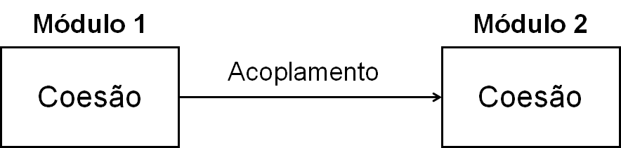

# Coesão e Acoplamento

Vimos que o desenvolvimento de projetos no paradigma de orientação a objetos pode fazer uso de vários padrões de projetos, e a estrutura e características técnicas podem ser representadas utilizando diagramas UML. **Em um projeto, temos um conjunto de módulos (métodos ou classes) interagindo entre si**. Queremos projetos de software **flexíveis**, **reutilizáveis** e com **fácil manutenção**, com uma complexidade que os desenvolvedores conseguem lidar. É nesse contexto que entram os termos coesão (*cohesion*) e acoplamento (*coupling*), que serão serão explicados e exemplificados a seguir.



## Coesão

**A coesão está relacionada com o módulo. Um módulo (classe ou método) deve ter um propósito único e bem definido**. Quando temos um módulo com um propósito bem definido, tratando apenas de uma tarefa específica, dizemos que temos uma **alta coesão**.

Um módulo com alta coesão possui responsabilidades bem definidas, e não tem mais responsabilidades do que deveria. Por outro lado, se um módulo tenta incorporar mais de um propósito, ou não tem um propósito bem definido, o módulo é dito de baixa coesão. **Em um projeto de software, queremos uma alta coesão, evitando módulos confusos ou ambíguos**.

## Acoplamento

**Outra forma de medir a qualidade de um projeto é pelo acoplamento, relacionado com a dependência entre os módulos**.

Um módulo com alta dependência de outros módulos é dito altamente acoplado (ainda mais se a integração com os outros módulos é bem específica). Por outro lado, se um módulo pode ser conectado à outros de forma simples, temos um baixo acoplamento.

Essa avaliação pode ser feita considerando:

- O grau (número de conexões entre outros módulos);
- Facilidade de uso (o quão intuitivo é utilizar o módulo, dispensando um entendimento profundo de seus processos internos);
- Flexibilidade (o quão intercambiável os outros módulos são em relação ao módulo sendo avaliado).

Nesse caso, queremos um baixo acoplamento, existindo pouca amarração entre os módulos e facilitando manutenção e substituição de módulos por eventuais melhorias. Além disso, um alto acoplamento pode dificultar a realização de alterações no código, que precisarão ser propagadas ao longo de vários módulos.

## Exemplos

Para entender como estes conceitos se traduzem na prática, serão apresentados alguns exemplos a seguir. A classe Email abaixo possui uma caixa de entrada e uma caixa de spam, representadas por arrays de Strings:

```Java
public class Email {
    private String[] caixaEntrada;
    private String[] caixaSpam;

    ...

    public String getEmail(int flagCaixa){
        int indiceEmail;
        String mensagem;

        // se a flag for 0, retorna o email mais recente da caixa de entrada
        if (flagCaixa == 0){
            indiceEmail = caixaEntrada.length;
            mensagem = caixaEntrada[indiceEmail - 1];
        } else {
            indiceEmail = caixaSpam.length;
            mensagem = caixaSpam[indiceEmail - 1];
        }

        // imprime e retorna a mensagem da caixa informada
        System.out.println(mensagem);
        return mensagem;
    }
}
```

Esse código possui **baixa coesão**. A classe Email faz diferentes tarefas dependendo da flag. A classe obtêm e-mail e imprime a mensagem antes de retornar (ou seja, tem duas responsabilidades). Isso pode ser um problema e pode dificultar a **reutilização**. Por exemplo, se eventualmente quisermos montar uma interface gráfica ou gravar o e-mail em um arquivo, seria preciso implementar um novo método. Isso aumenta a chance de termos código copiado/replicado em diferentes métodos, o que implicaria em problemas de manutenção do código (caso a forma de obter e-mail mude, por exemplo, seria preciso atualizar todas as partes que possuem esse código copiado/replicado). O ideal seria definir um método para obter e-mail (e que faz apenas isso) e outro para imprimir a mensagem. Dessa forma, o código possuiria **alta coesão**.

Para ilustrar um código com alto acoplamento, veja o exemplo a seguir:

```Java
public class Email {
    String[] caixaEntrada;
    String[] caixaSpam;

    ...

    public void aplicarFiltro(){
        FiltroSpam.filtrarSpam();
    }
}

class FiltroSpam {
    private static Email emails;

    ...

    public static void filtrarSpam() {
        int qtdSpam = 0;
        for (int i = 0; i < emails.caixaEntrada.length; i++)
            if (ehSpam(emails.caixaEntrada[i]) {
                emails.caixaSpam[qtdSpam++] = emails.caixaEntrada[i];
                emails.caixaEntrada[i] = "SPAM";
            }

        ...
    }
}
```

Nesse exemplo, a classe FiltroSpam irá filtrar os spams na caixa de entrada e incluí-los na caixa de spam. Contudo, a classe FiltroSpam tem uma dependência forte com relação à implementação da classe Email. O método filtrarSpam acessa diretamente os vetores caixaEntrada e caixaSpam de Email. Dessa forma, se eventualmente os nomes caixaEntrada e caixaSaida forem modificados ou se tornarem privados, por exemplo, seria necessário modificar a classe FiltroSpam também. Ou seja, há uma **dependência** forte entre as duas classes.

Uma alternativa para lidar com essa questão seria o método filtrarSpam não acessar caixaEntrada e caixaSpam diretamente. Isso é apresentado a seguir. Nessa nova implementação, o método filtrarSpam da classe FiltroSpam **não acessa mais detalhes internos da classe Email**. Isso inclusive permite que o método filtrarSpam seja mais facilmente **reutilizado** por outras classes em razão da diminuição do acoplamento. O método filtrarSpam não trabalha exclusivamente com a classe Email, agora qualquer classe que tenha um array de String pode utilizá-lo.

```Java
public class Email {
    private String[] caixaEntrada;
    private String[] caixaSpam;

    ...

    public void aplicarFiltro(){
        caixaSpam = FiltroSpam.filtrarSpam(caixaEntrada);
    }
}

class FiltroSpam {
    
    ...

    public static String[] filtrarSpam(String[] caixaEntrada) {
        ArrayList<String> listaSpam = new ArrayList<String>();
        for (int i = 0; i < caixaEntrada.length; i++)
            if (ehSpam(caixaEntrada[i]) {
                listaSpam.add(caixaEntrada[i]);
                caixaEntrada[i] = "SPAM";
            }

        ...
    }
}
```

## Boas Práticas

**No geral, é desejado que um projeto possua alta coesão e baixo acoplamento**. Isso pode facilitar a manutenção e a reutilização do código. Entretanto, é importante notar que módulos simplificados demais para atingir alta coesão podem levar a uma maior dependência de outros módulos, aumentando o acoplamento. O contrário também vale: se as dependências entre módulos forem simplificadas demais, diminuindo o acoplamento, os módulos podem ter muitas responsabilidades, diminuindo a coesão. Portanto, é importante balancear os dois objetivos no projeto de um sistema. Ter esses pontos em mente durante o desenvolvimento de um projeto é importante, pois pode ajudar a fazer um melhor projeto. Para isso, é interessante identificar e separar as responsabilidades entre os módulos.

## Referências

- [Curso Object-Oriented Design - University of Alberta - Coursera](https://www.coursera.org/learn/object-oriented-design)
- [1.3.1 – Coupling and Cohesion - University of Alberta - Coursera](https://www.coursera.org/lecture/object-oriented-design/1-3-1-coupling-and-cohesion-q8wGt)
- [Cohesion and Coupling: the difference - Enterprise Craftsmanship](https://enterprisecraftsmanship.com/posts/cohesion-coupling-difference/)
